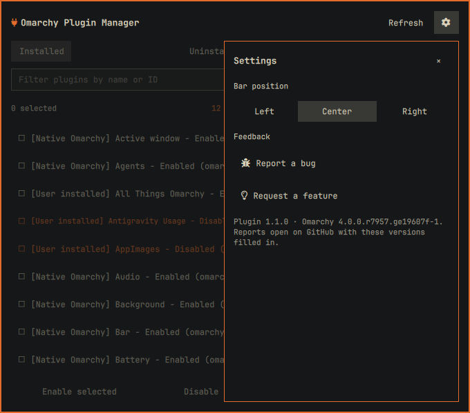
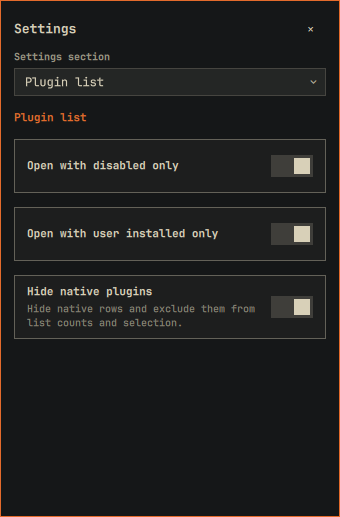

# Omarchy Plugin Manager

A native Omarchy shell bar widget for reviewing installed plugins and enabling,
disabling, or uninstalling them in batches, with restorable local backups and
persistent settings.



## Features

- Search installed plugins by name or ID.
- Distinguish **Native Omarchy** plugins from **User installed** plugins.
- Combine **Disabled only** and **User installed only** filters.
- Save default filters and optionally hide native plugins entirely.
- Highlight disabled plugins in the current theme's primary accent color.
- Choose when the bar icon uses the accent color and optionally display a
  disabled-plugin count.
- Select individual plugins or select all visible, eligible plugins.
- Batch enable, disable, or uninstall selected plugins.
- Keep local uninstall backups, restore plugins disabled, or permanently delete backups.
- See backup disk usage, set automatic retention, or delete all backups with
  confirmation.
- Report bugs or request features from the settings drawer; the GitHub issue
  form opens with the plugin and Omarchy versions already filled in.
- Scroll long lists using the mouse wheel or the draggable right-side scrollbar.
- Open the gear menu for a settings drawer with left, center, and right bar placement.
- Keep your preferences across shell restarts; optionally skip uninstall confirmation.
- Follow the active Omarchy theme and language, with English translations included.

By default the plug icon is white when every plugin is enabled and uses the
theme accent when any plugin is disabled. The settings drawer can change this
rule and add a disabled count beside the icon.

## Requirements

- Omarchy Quattro with the Quickshell-based shell, `qs.Ui` components, and
  `Commons.Translations`.
- The standard `omarchy` CLI, `jq`, and Python 3 (standard library only).
- JetBrainsMono Nerd Font for the plug and gear icons (included with Omarchy).

No separate service, build step, network polling, or API credentials are required.

## Install

```bash
omarchy plugin add https://github.com/kelmankenberg/Omarchy-Plugin-Manager.git --enable
```

The widget defaults to the right section of the bar. Change its placement from
the gear menu, or use:

```bash
omarchy bar move kel.plugin-manager --section left
omarchy bar move kel.plugin-manager --section center
omarchy bar move kel.plugin-manager --section right
```

The center option joins the centered group and can shift the clock. To place it
beside the clock without shifting that group, use `--section centerEnd` or
`--section centerBegin` from the command line.

## Usage

Click the plug icon to open the manager. Select the plugins you want to manage,
then click **Enable selected**, **Disable selected**, or **Uninstall selected**.
Uninstall requires a separate confirmation unless you opt out in settings.

Open **Uninstall history** to see removed plugins and their removal dates.
**Restore** puts the plugin back without enabling it; enable it from
**Installed** when ready. Restoration removes the entry from uninstall history.
**Delete** asks for confirmation before permanently deleting that backup. It
does not touch a separately installed copy with the same ID.

**Select all** and **Clear selection** apply to the currently visible, eligible
plugins. Existing selections hidden by a filter are retained: the selected count
and batch actions include them. Review your selection before applying an action.

Use **Refresh** to reload plugin states after changing them elsewhere. The list
also refreshes when the popup opens and after a batch action.

Click the gear to open settings. Close the drawer with its close button, the
gear, Escape, or a click on the shaded list. Escape closes the popup when the
drawer is already closed. Scroll within the drawer to reach backup controls
and Feedback.

### Settings



| Setting | Behavior | Default |
| --- | --- | --- |
| Default filters | Open with **Disabled only**, **User installed only**, or both. These defaults are reapplied whenever the popup opens. | Both off |
| Hide native plugins | Exclude native plugins from list rows, list counts, and selection. Ordinary search and filter controls still retain hidden selections. | Off |
| Icon accent rule | Accent when **any plugin** is disabled, when **a user plugin** is disabled, or **never** (always white). Independent of list filters. | Any disabled plugin |
| Show disabled count | Display a count beside the plug on horizontal bars. Counts follow the accent rule; always-white mode counts all disabled plugins. Hide the number when none are disabled. | Off |
| Backup retention | Keep forever or automatically delete backups after **7**, **30**, **90**, or **365 days**. | Keep forever |
| Backup disk usage and cleanup | Show allocated space and backup count. **Delete all backups** requires a separate permanent-deletion confirmation and never removes installed plugins. | No automatic cleanup |
| Skip uninstall confirmation | Uninstall immediately when clicked, still retaining a local backup. Manual backup deletion continues to require confirmation. | Off |

Bar placement and the bug-report/feature-request buttons are also in the drawer.
Preferences persist across shell restarts in
`${XDG_CONFIG_HOME:-$HOME/.config}/omarchy/plugin-manager/settings.ini`.

Retention defaults to **Keep forever**. Choosing an expiry opts into permanent
automatic deletion, including already-expired backups. Checks run when the
manager opens, after changing retention, and hourly while the shell is running.
There is no background timer when the shell is stopped. Disk usage measures
allocated local blocks without following symlinks.

### Bug reports and feature requests

Open the gear menu, scroll to **Feedback**, and select **Report a bug** or
**Request a feature**. Your browser opens the corresponding GitHub issue form
with the installed plugin and Omarchy versions filled in. Review and complete
the form before submitting; the manager never submits reports automatically.
A GitHub account is required to submit an issue.

You can also use the repository's [issue forms](https://github.com/kelmankenberg/Omarchy-Plugin-Manager/issues/new/choose).
When opening them directly rather than from the manager, enter the versions
yourself. The plugin version appears in settings, and `omarchy version` prints
the Omarchy version. Remove private information before attaching logs.

## Safety and removal

The manager uses Omarchy's plugin commands to change enabled state. Uninstall
then moves the plugin into local backup storage instead of using Omarchy's
destructive removal command. Batch operations are not atomic: if an enable,
disable, or uninstall operation fails, the remaining operations stop, the error
is displayed, and completed changes remain applied. Bulk backup cleanup attempts
each entry and reports any partial failures without deleting unexpected files.

- Native plugins cannot be uninstalled through this widget.
- The manager cannot disable or uninstall itself through its own list.
- Alternate full-bar plugins cannot be uninstalled through this widget. Enabling
  an alternate bar uses Omarchy's normal bar-switching behavior.
- Plugins Omarchy marks as non-disableable are excluded from batch enable/disable.
- Directory backups preserve the entire plugin folder, including `.git`, local
  modifications, and files the plugin stores inside its own folder.
- A symlink installation backs up **only the link**. Its external target is
  neither copied nor removed; restoring requires that target to still exist.
  Symlinks and external Git worktree metadata inside a directory also remain
  references, not independent snapshots.
- Restore never overwrites an installed plugin and clears its enabled entries
  through Omarchy before returning its files to plugin discovery.
- Uninstall history operations run in a separate worker, so shell plugin reloads
  do not interrupt a batch. A lock prevents competing history operations.
- An interrupted operation may leave a history record without backup files.
  Such entries are labeled and can be deleted without removing an installed copy.

### Backup storage

Backups and operation metadata live in the private, hidden directory
`~/.config/omarchy/plugins/.kel.plugin-manager-history/`, outside this plugin's
repository and excluded from Omarchy's plugin discovery. Keeping backups on
the same filesystem allows a rename instead of a potentially incomplete copy.

Backups have no expiry by default and continue using disk space until restored
or deleted (manually or by opt-in retention). The history allows up to 1,000
entries. Removing or updating the manager itself
does not remove them. Treat backups as private: they contain the original local
files and can include sensitive content stored by other plugins. This does not
back up files those plugins keep elsewhere, or preserve their old bar placement
and settings from `shell.json`.

The most recent operation result survives shell reloads. If a worker is
interrupted, history reports it rather than claiming success. Diagnostic output
is kept in `.worker.log` inside the backup directory.

To disable or remove this widget:

```bash
omarchy plugin disable kel.plugin-manager
omarchy plugin remove kel.plugin-manager
```

The manager requests no credentials or network access. Its placement and enabled
state live in Omarchy's `~/.config/omarchy/shell.json`; search, current filters, and
selection are session-only, while settings and default filters persist. Local
uninstall backups persist separately as described above.

## Development

Edit the installed plugin under `~/.config/omarchy/plugins/kel.plugin-manager/`.
Omarchy hot-reloads changes; do not edit the packaged shell under `/usr/share/omarchy/`.

```bash
omarchy plugin validate .
qmllint BarWidget.qml
PYTHONDONTWRITEBYTECODE=1 python3 -m unittest discover -s tests
node --test tests/test_placement.js
```

The placement regression tests additionally require Node.js (development only).

The stable plugin ID is `kel.plugin-manager`, independent of its display name.

## License

[MIT](LICENSE)
